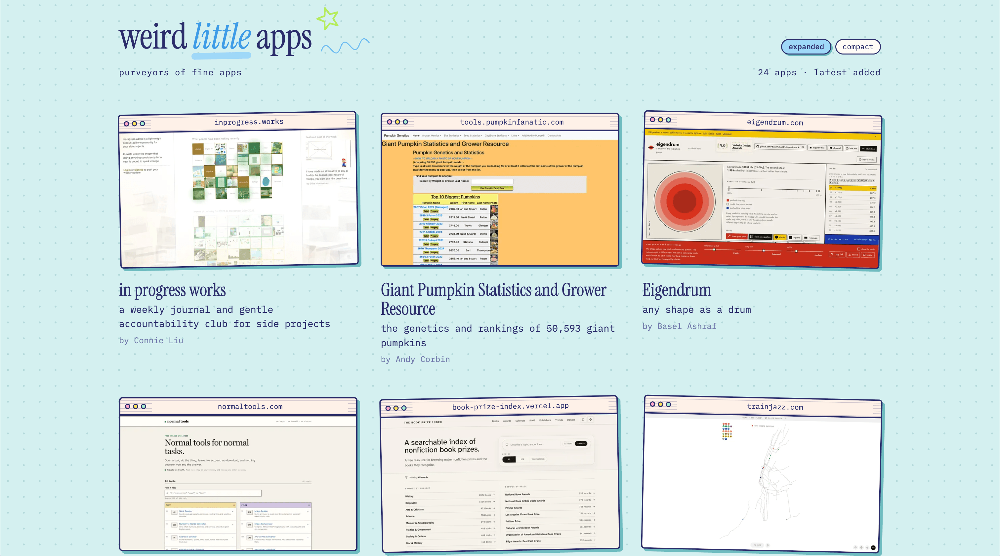
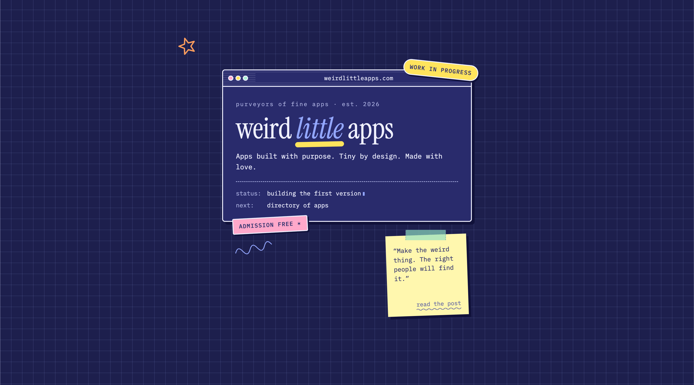
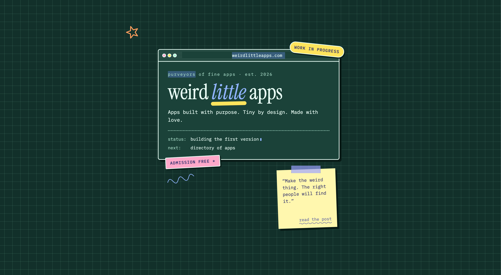
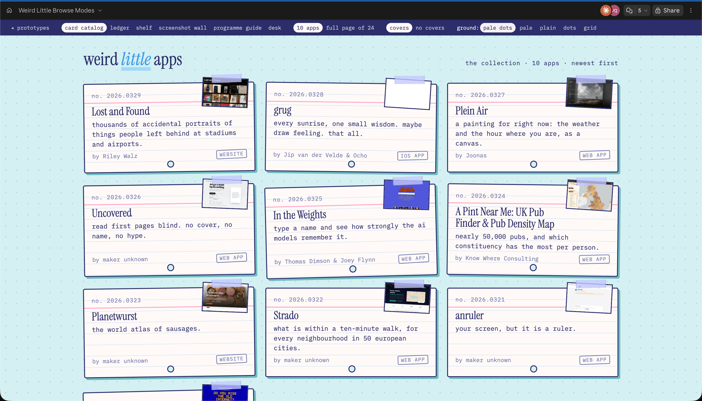
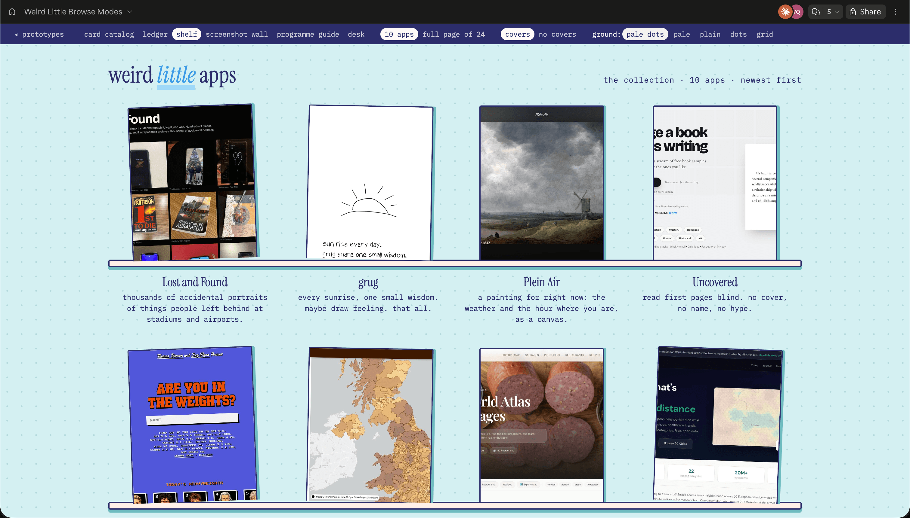
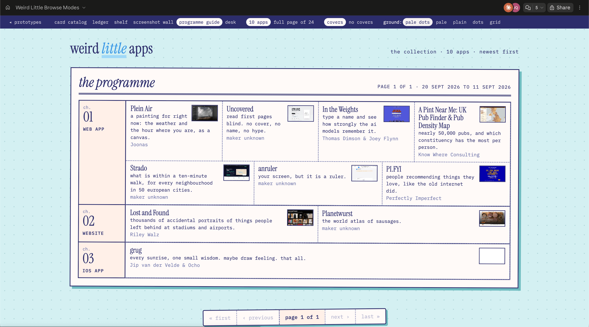
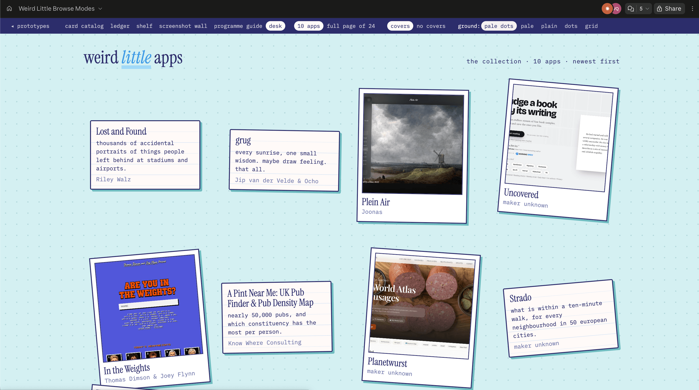
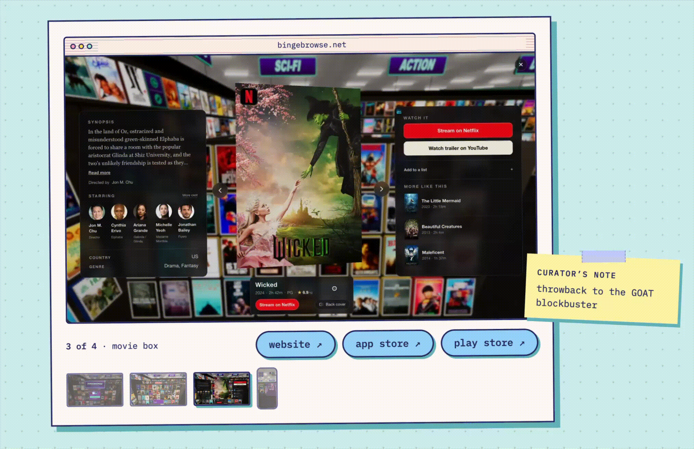
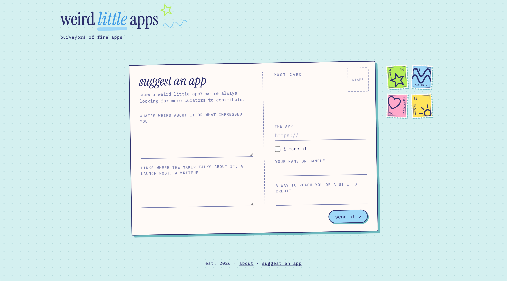

<em>"The Voyage of Life: Youth" by Thomas Cole (from <a href="https://www.nga.gov/artworks/52451-voyage-life-youth" target="_blank">National Gallery of Art</a>)</em>
 
In a [previous newsletter](https://vivqu.substack.com/p/making-space-for-weirdness-and-fun), I talked about the importance of making space for weirdness and fun. Coding agents have brought the cost of software creation down so far that anybody can now build their own custom tools. And now we're really starting to see people having fun building apps to suit their own specific, unique use cases.

For as long as there have been personal computers and the Internet, there have been attempts at bringing the power of coding to the masses -- from low-code/no-code platforms to WYSIWYG site builders to software consultants raking in $300/hr to build mobile apps. All these options were either too restrictive or inflexible or expensive to fully meet demand. But coding agents have democratized access beyond those with the relevant expertise. And with Fable-class models proving significantly more capable at software design and architecture, these AI-generated apps are finally well-formed enough to have rich feature-sets and complex functionality. We've broken past the limit of previous generations of models, which needed a firm guiding hand to prevent development from grinding to a halt. Even six months ago, if you didn't know what you were doing, your AI agent would be hopelessly lost in their own hallucinated spaghetti code as soon as you try to do something remotely interesting. 

Now you can build that ultra-custom thing for your hobby! You want to classify [all of David Attenborough's documentaries](https://weirdlittleapps.com/apps/attenborough-100/?ref=vivqu-blog)? Think that every recipe should be displayed in [table format](https://weirdlittleapps.com/apps/recipe-tables/?ref=vivqu-blog)? Turn all of NYC into [a pixel art map](https://weirdlittleapps.com/apps/isometric-nyc/?ref=vivqu-blog)? How about a site for [finding bootleg Knicks merch](https://weirdlittleapps.com/apps/knickknacks/?ref=vivqu-blog) during the 2026 NBA Finals? 

I'm frustrated that we don't have good language to describe this kind of software (["home-cooked"](https://www.robinsloan.com/lab/ask-for-what-you-want/) is maybe the closest). Vibe-coding and AI slop all suggest a fundamental lack of care in the creation of the thing. But people building on a small scale can put more craft and care into the execution of an idea than even the largest tech companies in the world. You can still put days and weeks into making something good even if you don't look at the code these days. It's the opposite of slop, in fact: instead of farting out the bare minimum crap to farm clicks or grab eyeballs from our ever-rotting attention spans, these projects are full of intention. The passion practically radiates through the screen!

So many of the best things that exist today are here because one person loved it enough to devote immense time and energy to making it happen. As John Collison put it:

<blockquote class="twitter-tweet tw-align-center">
As you become an adult, you realize that things around you weren&#39;t just always there; people made them happen. But only recently have I started to internalize how much tenacity *everything* requires. That hotel, that park, that railway. The world is a museum of passion projects.
&mdash; John Collison (@collision) <a href="https://x.com/collision/status/1529452415346302976?ref_src=twsrc%5Etfw">May 25, 2022</a></blockquote> 

There's still no certainty about where the rapid development of AI will take us. One wonderful outcome from all this pell-mell could be giving us back more time from the improved productivity. Liberated from work, we might fill our leisure time with creativity and making things. But as Julie Zhou [writes](https://lg.substack.com/p/a-bird-wall-a-talking-rotary-phone), it can feel like this is frivolous:

> Leisure, to many, is not a “good” reason for AI, especially when the stakes seem to center around whether you’ll be a part of the permanent underclass or who will win in global geopolitics or whether there is a 10% chance the human race will be destroyed.
>
> But I can think of no better reason for leisure than the idea of _agency_ itself: the drive to create that comes from a personal sense of freedom and choice.

I made [Weird Little Apps](https://weirdlittleapps.com/?ref=vivqu-blog) to celebrate the one-off creations, from the frivolous to the serious. I am delighted by all the ideas that are bubbling forth that I would never in my life ever dream up. And there's probably more out there that are not visible to me! Cool ideas are popping up left and right. What little gems are out there, glowing softly in the dark, that simply need to be uncovered?

I am practicing what I preach, too. I used coding agents to set up all the scaffold and plumbing for the website (thanks Claude!). But the care and attention to detail for the final product was the bulk of the work. You'll notice it doesn't [look like](https://www.reddit.com/r/webdesign/comments/1w4r7dj/is_everyone_using_the_same_website_builder_or/) an AI-generated website.

 

*Built in the style of a retro computer.*
 

That's because I spent weeks [gathering design inspiration](https://kinopio.club/august-4-2026-pxZyv4GmlSQmiCd_CcgVz) for the specific aesthetic I wanted to achieve with the design. 

  <iframe src="https://kinopio.club/embed/?spaceId=pxZyv4GmlSQmiCd_CcgVz&zoom=45" style="height: 100%; width: 100%; border: 0; border-radius: 6px;">
  </iframe>

The careful research results in a curated look that the AI would never be able to come up with on its own. I could then generate design principles to guide the visual output to be better. 

DESIGN.md

Personal homepages from the small web: pages that feel made by one person, for fun, on a desk rather than in a design tool. 

- **Paper, not glass.** A pale aqua ground with a dot grid showing through.
- **Things, not layouts.** Retro browser windows, a drawn phone, a paper mat, a printout with sprocket holes, sticky notes, tape, a ticket stub, all slightly askew.
- **Ink outlines and hard shadows.** Like a risograph print or a sticker sheet.
- **Two typefaces, deliberately mismatched.** An italic serif for the one big line, monospace for everything else.
- **A few spot colors, used flat.** Each accent belongs to one object.
- **Doodles in the margins.** A star, a squiggle, a little wobbly.
- **Lowercase, plain-spoken copy.** A person keeping a homepage, not a company launching a product.
- **Light and bright.** No dark mode.

I then spent days using a generated Claude artifact to iterate and edit the UX so that the usability was high and the information architecture made sense.

<figure><figcaption>Color explorations.</figcaption></figure>
<figure><figcaption>More color explorations.</figcaption></figure>
<figure><figcaption>In a card catalog.</figcaption></figure>
<figure><figcaption>Sitting on a shelf.</figcaption></figure>
<figure><figcaption>TV programming.</figcaption></figure>
<figure><figcaption>Polaroids on a desk.</figcaption></figure>

I spent an hour just tuning the animation between desktop and mobile screenshots for the minor cases when an app is cross-platform and you want to page through the screenshots with the arrow keys. What kind of weirdo cares about these details for a casual hobby website? 

 

*<a href="https://weirdlittleapps.com/apps/bingebrowse/?ref=vivqu-blog" target="_blank">Bingebrowse</a> putting coding agents to the test.*
 

I spent many hours designing the [suggestion form](https://weirdlittleapps.com/suggest/?ref=vivqu-blog) to look and behave like a postcard, just because it was fun.

 

*Choose a stamp, fill out an app suggestion, and send it in the mail!*
 

And last but not least: I write every single word and choose the screenshots on the detail pages myself. Every app on the website is hand-curated and manually updated. All the images are stored with a timestamp in case the app changes or it's no longer accessible because of [link rot](https://www.theatlantic.com/technology/archive/2021/06/the-internet-is-a-collective-hallucination/619320/). A record of these collected apps will be available as long as I keep the website up.

Ada Palmer and Ken Liu are interviewed in this great piece, [Six Gutenberg Revolutions in a Row](https://asteriskmag.com/issues/16/six-gutenberg-revolutions-in-a-row). In it, they discuss science fiction visions for our post-AI future. One of these flourishing directions could be the "Etsy economy" where people fill their time making lovely little things:

>But look at our present: There are so many meaningful vocations people would love to do and don’t, because meaningful vocations are economically exploited. We don't pay teachers. We don’t pay people who do social work, or care for the environment, or rehabilitate injured seagulls. We don't pay our artists and actors much, except a very few. A lot of people, given a steady paycheck to live on, would much rather work at the bat sanctuary. 
> 
> Another future I enjoy playing with is: What if the future is the Etsy economy, where we all make beautiful handcrafted bespoke things and buy them from each other? Maybe you enjoy drawing pterodactyls, maybe crochet. Everybody enjoys making and doing things. A future where we all make and do things and purchase them from each other is a beautiful future.

This webpage for weird little apps is my way of keeping track of the making and doing now in our time of runaway AI progress. I look forward to a possible future where we have the time and space to make more beautiful handcrafted things.

If you have a weird little app you would like to share, please [submit a suggestion](https://weirdlittleapps.com/suggest/?ref=vivqu-blog)! Credit will go to the original curator of the app.

<footer>This article was last updated on 11/11/2026. v1 is 1,550 words and took 3.5 hours to write and edit.</footer>
